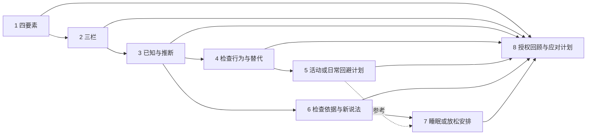

# 八课代码阅读与本轮报告对照

日期：2026-10-16。本轮相对 `course-guided-v2` 的前三课实现补齐第 4—8 课；当前版本为 `course-guided-v3` / `guided_cbt_v3`。依据[实现规格](spec.md)，后续专项理解测试[另列待执行清单](understanding-tests.md)。

## 1. 先分清继承和新增

旧版已经有六阶段、结构化摘录、本人确认、单课授权摘要、四种反思策略、加密幂等与独立课后复盘。这些是本轮复用的基础，不应写成本轮新发明。

| 项目 | 之前 | 本轮改动 | 作用与边界 |
| --- | --- | --- | --- |
| 课程范围 | 前三课运行，4—8 目录占位 | 新增五课独立材料、字段、问题、示例、课后安排 | 八课可运行，尚不等于理解质量已验证 |
| 记录字段 | 每课固定四要素/三栏等 | `required_fields(state)` 按课次和本人路径返回字段 | 同一运行时支持记录、计划、证据检查和回顾 |
| 第 5、7 课二选一 | 目录文案，没有实现 | 确定性路径选择、重选及快照保存 | 模型不能代选，重选不能混入旧路径确认 |
| 课间采用 | 三栏为主要结构 | 只采用本课需要且语义相同的情境字段 | 不把旧计划直接改写为新行为或新目标 |
| 第 8 课回顾 | 单一来源摘要 | 每个前课最新成果的紧凑摘要，逐项复核 | 可缺课、拒绝回顾；不拼前课全部聊天 |
| 反思适用性 | 按阶段、案例、缺失字段 | 追加路径条件，重选时撤回活动建议 | 频率策略不变，效果仍待实验 |
| 完成表达 | 已确认成果与课后选择 | 成果显式标记 `application_status=not_measured` | 一份计划不等于实际执行或改善 |
| 工程证据 | 三课轨迹与回归 | 八课、所有分支、引用撤回与 API 完成回归 | 证明代码路径，不证明真实模型语义能力 |

公共 Schema 和行为发生变化，前三课版本也递增，旧会话保留只读、不自动迁移；避免同版本混入不同契约。没有新增数据库表。

成果使用 `course-artifact/2`，`kind` 分 learning_record、action_plan、coping_plan；摘要保留类型及 `application_status`，让后课也能区分一份计划和已验证的生活运用。

## 2. 八课的数据依赖



图示是优先的数据联系，并非强制先修门禁。具体来源优先级在 [design.py](../../cbt_course_llm_freeform/design.py) 的 `PREDECESSORS`；所有课都可从本课回答独立完成。

| 课 | 本课核心数据 | 前课使用方式 |
| --- | --- | --- |
| 1 | situation / thought / emotion / behavior | 新例子 |
| 2 | situation / thought / emotion | 可明确沿用第 1 课同名字段 |
| 3 | 三栏 + awareness_note；独立 pattern_review | 优先第 2 课，否则第 1 课 |
| 4 | 情境、心情、实际做法、做法作用、替代、边界 | 优先第 3、2、1 课，缺少字段从本课补 |
| 5 | activation：意义、小步、安排、阻碍、边界；exposure：另加担心与台阶 | 优先第 4 课；只沿用情境，不导入替代计划为已做行为 |
| 6 | 三栏 + 支持/不同信息 + 本人新说法 + 下一步 | 优先第 3、2、1 课，不从活动计划推断本人想法 |
| 7 | sleep：睡眠情况/习惯；relaxation：信号/方式；均加小步/安排/边界 | 可参考第 6、5、4 课；各自字段从本课回答取得 |
| 8 | 早期信号、本人选用技能、应对、支持、回看安排 | 多课摘要只作参考，本课字段仍需本人表达 |

## 3. 最短代码阅读路线

1. [catalog.py](../../cbt_course_llm_freeform/catalog.py)：课次、版本、开放状态。此层不管理聊天。
2. [design.py](../../cbt_course_llm_freeform/design.py)：`REQUIRED_FIELDS` 是基本字段；`PATHS` 定义两门分支课的字段/示例；`required_fields()`、`lesson_example()`、`task_step_id()` 读取当前状态。
3. [lesson_4.py](../../cbt_course_llm_freeform/lesson_4.py) 到 `lesson_8.py`：独立领域材料与注意点；[prompt.py](../../cbt_course_llm_freeform/prompt.py) 拼公共约束、本课材料和自动生成的 Schema。
4. [schemas.py](../../cbt_course_llm_freeform/schemas.py)：API action 和模型字段枚举。扩大枚举不代表模型能任意填写；当前阶段/路径的业务许可在运行时检查。
5. [runtime.py](../../cbt_course_llm_freeform/runtime.py)：`process()` 生成候选状态、调用模型、检查摘录并推进；`_control()` 处理本人选择、重选、采用、确认、课后安排与完成。
6. [memory.py](../../cbt_course_llm_freeform/memory.py)：来源选择、紧凑回顾、每次复核；[services.py](../../cbt_course_llm_freeform/services.py) 负责加密事务、租约和逐次调用审计。

前端 [course.js](../../webapp/static/cbt_course/course.js) 根据服务端 payload 展示可选路径、字段和来源；它不会自行判断已经学会。模型调用仍是 [agent.py](../../cbt_course_llm_freeform/agent.py) 的 teaching / guidance_reflection / guidance_actor 三种角色，普通轮次未触发时仅 teaching 一次。

## 4. 跟踪第 5 课的一次选择

`skip_checkin` 进入 learn，`needs_path_choice=true`，任务 ID 是 `learn:choose_path`。页面暂时禁用聊天输入，展示两个本人按钮；后端同样拒绝绕过选择直接推进。

本人点击 `choose_activation` 后，程序写入 `path=activation`，不调用模型。`required_fields()` 返回本路径的六个字段。示例回答之后进入 practice，当前任务可能是 `practice:activation:situation`；模型只能提议当前路径字段的摘录。

```json
{
  "reply": "如果遇到阻碍，您想怎样调整？",
  "observations": [{"field": "first_step", "value": "先看看窗边的一盆花", "source_message_id": "本轮本人消息ID"}],
  "advance": false,
  "assessment": {"signals": []},
  "domain_candidates": []
}
```

Pydantic 检查形状，运行时另查字段许可、消息来源与精确摘录。若 activation 路径返回 `feared_prediction` 或 `sleep_pattern`，即使原话真实也会拒绝。字段齐全后进入 review，本人确认，再选择是否安排课后尝试，最后才能完成。

`change_path` 会撤回旧路径草稿、确认、学习证据和课后安排，生成新 case_id，清除活动建议并重开 learn；旧消息和调用仍留在审计中。完成后的会话不允许重选。确认快照及成果均保留 path。

## 5. 同一个字段名也要有语义边界

第 4 课的 `alternative_action` 是考虑中的替代做法，不是第 5 课已经做过的行动。[runtime.reusable_fields()](../../cbt_course_llm_freeform/runtime.py) 只允许 situation/thought/emotion/behavior/awareness_note 中本课需要且来源存在的字段。

采用字段保存 `{value, source_artifact_id, source_field, adopted_by_message_id}`；本课摘录保存 `{value, source_message_id}`。授权参考摘要不自动复制；选择沿用才产生采用记录。不做跨字段语义转换，也不把计划写成实际效果。

## 6. 第 8 课如何回顾多课

`offer_previous_summary()` 为第 8 课查找第 1—7 课每课最新的合法成果。每份摘要取两个相关字段，单值最多 180 字，截断会显式标记；`reference_only=true`，不能直接当本课采用记录。

```json
{
  "status": "offered",
  "kind": "course_review",
  "sources": [{"source_conversation_id": "前课会话ID", "summary": {
    "lesson_id": "lesson-6", "artifact_id": "前课成果ID", "compact": true,
    "reference_only": true, "record_order": ["balanced_thought", "next_step"],
    "record": {"balanced_thought": {"value": "目前我还不知道原因", "truncated": false}}
  }}]
}
```

示例省略标签和来源元数据。本人接受后，模型 context 才得到 `authorized_previous_lesson_summaries`；拒绝时为空。`refresh_carryover()` 逐份检查归属、版本、完成与确认，失效来源移除，全部失效则撤回引用。不在刷新时偷偷增加新来源。

完成成果的 `referenced_artifact_ids` 记录当时可用的已授权参考来源，**不是这些方法都已被本人用过或有效的证明**。本人 helpful_skill 仍须来自本课回答，不能把某课完成直接当成偏好。

## 7. 如何复现与看证据

在模块根目录执行：

```powershell
.venv\Scripts\python.exe -B scripts\run_regression.py
.venv\Scripts\python.exe -B scripts\trace_course_workflow.py --policy event_driven
.venv\Scripts\python.exe -B scripts\trace_course_workflow.py --policy per_turn --activity-path exposure --wellbeing-path relaxation --output test-results/course-workflow-eight-alternate.json
.venv\Scripts\python.exe -B scripts\run_course_preview.py --port 8001
```

轨迹是固定虚构案例和规则客户端，记录 path、task_step、字段来源、触发理由、各次模型调用及短反思；正常部署仍使用原有真实模型配置。网页示例每轮最多补四个待补字段，字段多时分轮填写，不扩大单次契约来假装一次填完。

验证结果和页面证据见[工作清单](tasks.md)。后续专项测试先核对真实模型能否正确理解和记录，再比较反思频率及内容；本轮没有真实模型评分或学习效果结果。
